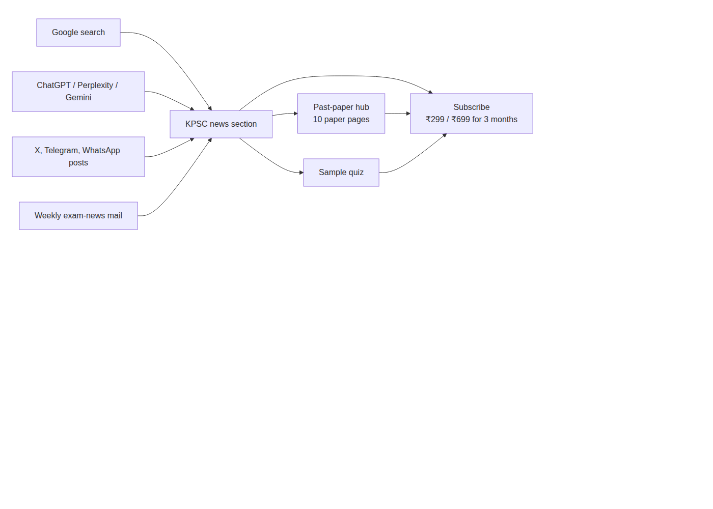
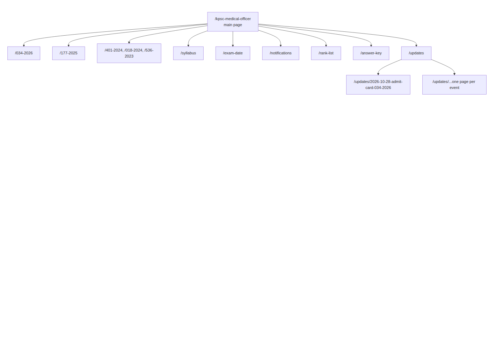
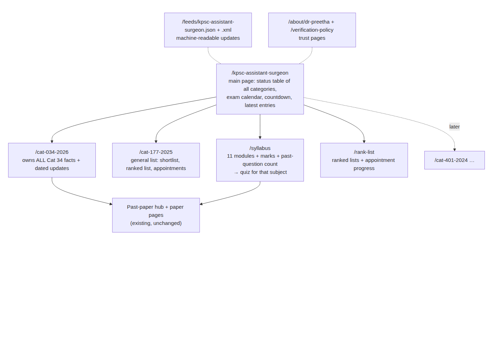
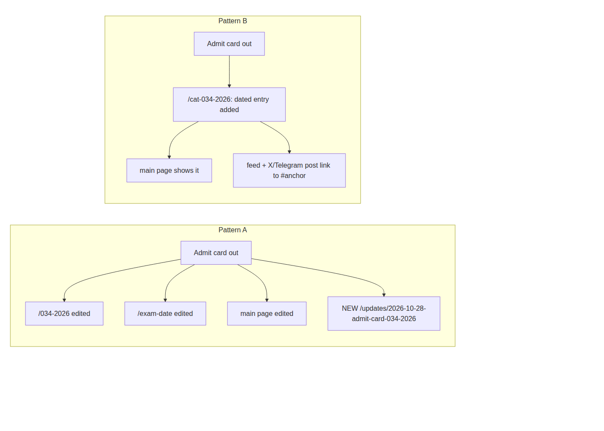

# drpreetha.com — KPSC news section: choose a pattern

*20 Oct 2026. Two page structures for the new public section on Kerala PSC Assistant Surgeon / Medical Officer news,
notifications, syllabus and rank lists. Read both, then pick A or B, plus the two smaller choices at the end.*

Reviewed by two models through page-designer: **Qwen 3.8-max** (the designer) and **Gemini 4 Argon** (the independent reviewer).
Full reviews: [qwen-review.md](ia-review/qwen-review.md) · [second-review.md](ia-review/second-review.md) · [input given to them](ia-review/hierarchy.md)

---

## The short version

| | **Pattern A: "Many pages"** | **Pattern B: "Few strong pages"** |
|---|---|---|
| Idea | A separate page for every topic and every news event | One page per category that owns all its facts, plus a few topic pages |
| Main address | `/kpsc-medical-officer` | `/kpsc-assistant-surgeon` |
| Pages at the start | ~12, growing by 1 for every news event | ~5, growing only when PSC opens a new category |
| News events | Each gets its own page (`/updates/...`) | Each becomes a dated entry on its category page + in the feed |
| Reviewer scores, SEO | Qwen 6.5, Gemini 5 | Both reviewers recommended this direction |
| Best when | The site already has authority and many visitors | The site is small and new to these searches (**our case today**) |

**My recommendation: Pattern B.** It suits a 22-page site with ~177 visits a month. We can move to A later
once Google trusts the section. Moving from B to A is easy; going the other way means redirects.

---

## How visitors and Google reach us (both patterns)

Both patterns use the same verified facts (taken only from official keralapsc.gov.in PDFs, approved by you on Telegram)
and both send people to the past papers, quiz and subscribe page. The difference is **how many pages those facts are spread over**.

---

## Pattern A: "Many pages"

**How it works:** every kind of information and every news event gets its own address.
The admit card on 28 Oct would appear on `/034-2026`, on `/exam-date`, on the main page *and* as a new `/updates/...` page.

**Advantages**
- One page per search phrase in theory ("exam date", "rank list", "answer key", "notification").
- Every news event creates a brand-new page, which can be shared on its own and signals freshness.
- Looks like the big sites (testbook, toppersexam, entri) that rank today.
- Easy to understand for editors: "new thing → new page".

**Disadvantages**
- **Pages compete with each other.** Four of our own pages would chase the same "admit card 034/2026" search.
  Google then picks one, often the wrong one, and the others are wasted. Both reviewers flagged this.
- **Thin pages.** `/notifications`, `/exam-date` and `/answer-key` would mostly be short lists of links for months.
  Google treats many thin pages as a weak site, and on a 22-page site they would be half of everything.
- The big sites can afford this because Google already trusts them; we can't yet.
- More pages to keep correct. One date change must be fixed in 4 places, and the nightly job does more work.
- `medical-officer` in the address misses the official post name **Assistant Surgeon / Casualty Medical Officer**, which is what candidates type.

---

## Pattern B: "Few strong pages" (recommended)

**How it works:** each category page is the single home for its facts. The admit card on 28 Oct is added as a
dated line ("28 Oct 2026 — admit card released, source: KPSC PDF") on `/cat-034-2026`, shown on the main page,
and published in the feed. The syllabus and rank-list pages **link** to the category page instead of copying its tables.

**Advantages**
- **No self-competition.** One clear page for each search: Cat 34 searches → `/cat-034-2026`, syllabus → `/syllabus`.
- Every update makes an existing page **stronger and fresher** instead of creating a new weak page.
- Uses the official post name in the address (Gemini's main point). "Medical Officer" still appears in titles and headings, so both phrases are covered.
- Pages are long and complete, which AI tools prefer to quote (Gemini scored this 8/10 for AI citation).
- The JSON feed and `llms.txt` give AI agents one clean place to read every category, date and source PDF.
- Less to maintain: a date change is fixed in one place.

**Disadvantages**
- No separate page per news event, so each X/Telegram post links to the category page (with `#28-oct-admit-card`-style anchors) rather than a dedicated article.
- Fewer total pages, so fewer "lottery tickets" for odd searches.
- Category pages get long over a full exam cycle and need good on-page navigation (jump links, a timeline at the top).
- Qwen would keep separate update pages for freshness; this pattern overrules that view.

---

## How the 28 Oct admit card would appear in each pattern

---

## Same in both patterns

- Facts only from official keralapsc.gov.in PDFs, checked by code, approved by you on Telegram before going live.
- Every fact shows "Source: Kerala PSC", the PDF link and the date checked.
- Two-line answer at the top, "Last updated", Dr Preetha as reviewer, a short visible FAQ.
- Links to the past-paper hub, matching paper, sample quiz, subscribe page.
- Menu item "KPSC News"; sitemap, Search Console, Bing Webmaster, IndexNow; AI crawlers allowed.
- Built with page-designer, checked on phone (390 px) and desktop (1366 px) before going live.

## Choices for you

1. **Pattern:** A (many pages) or **B (few strong pages, recommended)**?
2. **Main address:** `/kpsc-assistant-surgeon` (official post name, recommended) or `/kpsc-medical-officer`?
   *(Search Console impressions over the next weeks can confirm which phrase people use more; I don't have volume figures today.)*
3. **Reviewer name:** OK to show Dr Preetha (MBBS, MS ENT) as reviewer on these pages?

If B: build order before the 28 Oct admit card is **`/cat-034-2026` → `/syllabus` → main page → `/cat-177-2025` + `/rank-list`**.
